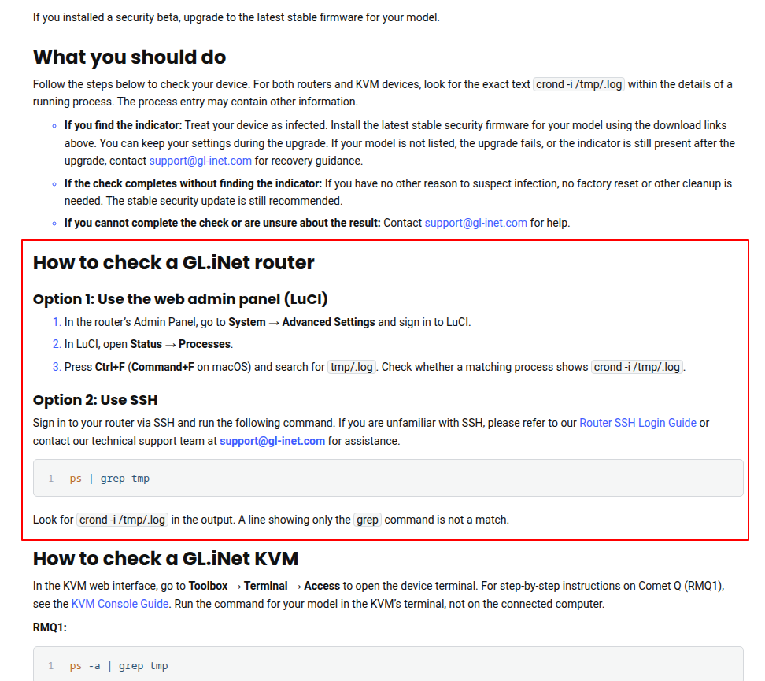

# GL.iNet's statements over time

A running record of what GL.iNet has said in public about this incident, and how it changed.
When GL.iNet changes its wording, the earlier statement stays here with its date.

The main source is GL.iNet's
[security notice](https://forum.gl-inet.com/t/2026-11-20-gl-inet-security-notice-goodcloud-kvm-routers/73056),
the first post of that forum topic. The forum shows when a post was last edited but does not
show earlier versions to the public, so this record rests on the copies we saved. Each entry
gives the forum's edit time of the version and when we saved it. The entries are our summaries;
short passages in quotation marks are GL.iNet's words. We hold the full text of each version.

The post was created on 21 November 2026 at 07:57 UTC and had been edited three times before
our first copy. We do not have those first three versions.

## At a glance

| Subject | 21 Nov, 10:35 UTC | 21 Nov, 14:10 UTC | 21 Nov, 16:00 UTC | 23 Nov, 01:53 UTC |
|---|---|---|---|---|
| What owners should do | Factory reset every router and KVM, set it up again, install the firmware when released | Advice removed; two links to "quickly check" topics | Check for one process; if found, KVM beta firmware or factory reset; if not found, nothing | Install the security firmware; settings can be kept; no factory reset needed |
| Factory reset | Recommended for all router and KVM users | Not mentioned | An option if the indicator is found; not needed otherwise | Not required, also when the indicator is found |
| How to tell if a device was hit | Contact support | Two forum topics | One indicator: a process containing `crond -i /tmp/.log` | The same indicator, and an admission that the official checks may miss affected devices |
| What GL.iNet did on devices | "Implemented corrective measures … on affected devices" | The same sentence | Sentence gone | Not mentioned |
| Does blocking the attack clean a device | Not addressed | Not addressed | No: blocking does not remove malware already installed | No; the firmware is said to remove it |
| Fixed firmware | Being prepared | Being prepared | KVM beta now; stable for routers and KVMs on 22 November | Stable for 18 router models and 7 KVM models, with minimum versions |
| Community script | Not mentioned | Not mentioned | Not mentioned | Linked as an optional, unofficial check, with a disclaimer |

## Version edited 21 November 2026, 10:35 UTC

Saved by us at 12:53 UTC that day. Its own header reads "Last updated November 21, 2026, 04:25 UTC".

- A vulnerability in the cloud remote management services was exploited to install malicious
  software on "a subset" of routers and KVM devices.
- Under "What we have done": the vulnerability in the cloud services was closed; corrective
  measures were implemented "on affected devices"; an investigation was under way.
- Under "What we will do next": a firmware update "as soon as possible"; an individual email to
  everyone affected; investigation of the scope, including computers connected to affected
  KVMs.
- Not sure if your device was affected: contact support.
- **Recommended for all KVM users:** factory reset, set the device up again, check the
  connected computer, install the updated firmware when released.
- **Recommended for all router users:** factory reset, set the router up again, install the
  updated firmware when released.
- No indicator, no check, no list of models.

## Version edited 21 November 2026, 14:10 UTC

Saved by us at 15:24 UTC that day. The header still reads "04:25 UTC".

- **The factory reset recommendation for routers and KVMs is gone.** The whole "What we
  recommend" section was removed.
- In its place, under a heading about whether a device was affected: links to two forum topics,
  "Quickly check if your router is under attack" and "Quickly check if your KVM is under
  attack".
- The rest is unchanged, including the sentence about corrective measures on affected devices.

## Version edited 21 November 2026, 16:00 UTC

Saved by us at 16:41 UTC that day, and again unchanged at 07:12 UTC on 22 November. The header
reads "Last updated November 21, 2026 (UTC)". This version was rewritten throughout.

- New: "The attack path has been blocked." Devices can no longer be newly infected through it.
  These measures do not remove malware from devices already infected.
- **The sentence about corrective measures implemented on affected devices is gone.**
- New: one indicator for routers and KVMs, the exact text `crond -i /tmp/.log` in a running
  process, with the four ways to look for it that are still in the notice.
- If the indicator is found: treat the device as infected. For a KVM, install the security beta
  firmware; or restore the device to factory settings. Install the stable firmware when
  available.
- **If the indicator is not found** and there is no other reason to suspect infection: no
  factory reset or other cleanup is needed.
- If a KVM is infected, check the connected computer.
- KVM beta firmware with fixes listed for seven models (1.10.2 beta, or 1.8.6 beta for the
  RMQ1). Stable firmware for routers and KVMs scheduled for 22 November 2026.
- Notification by email to the owners GL.iNet identifies as affected.

## Version edited 23 November 2026, 01:53 UTC

Saved by us at 02:38 UTC that day. The header reads "Last updated November 23, 2026 (UTC)".
This is the version summarised in the README under "What GL.iNet has said".

- New section: install the latest stable security firmware for your exact model, even if the
  checks find nothing.
- **New claim:** the security firmware removes the malware identified in this incident without
  a factory reset, and existing settings can be kept during the update.

  

  *The same passage on GL.iNet's own site
  ([gl-inet.com](https://www.gl-inet.com/en-us/blogs/blog/glinet-security-notice-2026-11-20)),
  screenshot taken on 23 November 2026, not later than 05:31 UTC. The red box is ours.*
- **If the indicator is found, the factory reset option is gone.** The instruction is now to
  install the security firmware, with settings kept; contact support if the indicator is still
  there afterwards or the model is not listed.
- New: minimum fixed versions for 18 router models and 7 KVM models, and the sentence that an
  unlisted model is not necessarily unaffected.
- **New admission:** further indicators have been identified, and the official quick checks
  "may not detect every affected device". The community script is linked as an optional,
  unofficial, more comprehensive check, with a disclaimer.
- Unchanged: the indicator and the four checks; "no factory reset or other cleanup is needed"
  when the indicator is not found; the email notifications; the continuing investigation.

  

  *The "What you should do" and "How to check a GL.iNet router" passages on GL.iNet's own site,
  screenshot taken on 23 November 2026, not later than 05:32 UTC. The red box is ours.*

## GL.iNet staff posts in the forum

This section records, in time order, what GL.iNet staff said about the incident in the public forum
at https://forum.gl-inet.com . It is a companion to the record of the security notice itself. Only
forum posts are included; nothing from private messages or support emails. "Staff" means a member of
the forum group `GL.iNet_Staff`: **AdamK, alzhao, bruce, charles2, robotluo, snowisland, Thalia,
will.qiu**. Summaries are neutral; short quoted phrases (under 15 words) are in quotation marks.
Times are UTC.

AdamK is in the staff group; some of his posts go further than the official notice. They are
listed as posted. The community researcher who posts as **admon** is a volunteer moderator, not
GL.iNet staff, and is not listed here.

| UTC time | Staff | What was said | Post |
|---|---|---|---|
| 2026-11-21 12:33:03 | snowisland | First KVM security firmware (1.10.2): "enhances the security of the Cloud Computing Platform's remote management service"; beta links. | [73058/5](https://forum.gl-inet.com/t/kvm-safety-release-1-10-2-release1/73058/5) |
| 2026-11-21 12:48:24 | will.qiu | The KVM fixed firmware was first shared via Google Drive; now in the Download Center, so that thread was unlisted. | [73056/30](https://forum.gl-inet.com/t/2026-11-20-gl-inet-security-notice-goodcloud-kvm-routers/73056/30) |
| 2026-11-21 14:05:11 | robotluo | Links the two quick-check threads: KVM and router. | [73056/37](https://forum.gl-inet.com/t/2026-11-20-gl-inet-security-notice-goodcloud-kvm-routers/73056/37) |
| 2026-11-21 14:28–14:54 | bruce | To several users, their `ps \| grep tmp` output is "safe" / "healthy" / "not compromised". | [73070/5](https://forum.gl-inet.com/t/quickly-check-if-your-router-is-under-attack/73070/5) |
| 2026-11-21 15:17:00 | alzhao | To a vanilla-OpenWrt GL-MT6000 user: "Not affected." | [73070/17](https://forum.gl-inet.com/t/quickly-check-if-your-router-is-under-attack/73070/17) |
| 2026-11-21 15:20:10 | AdamK | `ps \| grep tmp` is "simply a point-in-time check"; does not show prior compromise or on-disk persistence. | [73070/19](https://forum.gl-inet.com/t/quickly-check-if-your-router-is-under-attack/73070/19) |
| 2026-11-21 15:40:13 | alzhao | To a user: "Seems that you are under attack. We received your email and will contact you there." | [73070/25](https://forum.gl-inet.com/t/quickly-check-if-your-router-is-under-attack/73070/25) |
| 2026-11-21 16:00:14 | bruce | "The original post has been updated, please check the latest updates" (link to the notice). | [73056/52](https://forum.gl-inet.com/t/2026-11-20-gl-inet-security-notice-goodcloud-kvm-routers/73056/52) |
| 2026-11-21 16:11–16:13 | AdamK | Adds reverse-shell checks: `netstat -tnp \| grep '170.39.226.219'`, process hunts; a negative quick check "is not sufficient". | [73070/32](https://forum.gl-inet.com/t/quickly-check-if-your-router-is-under-attack/73070/32) |
| 2026-11-21 16:27:11 | alzhao | Warns `netstat` "can be compromised and running it will start the malware"; shows the healthy case `/bin/netstat -> busybox`. | [73070/41](https://forum.gl-inet.com/t/quickly-check-if-your-router-is-under-attack/73070/41) |
| 2026-11-21 16:37:18 | AdamK | `/tmp` is in RAM, so its contents are lost on reboot; check and preserve evidence before rebooting. | [73070/43](https://forum.gl-inet.com/t/quickly-check-if-your-router-is-under-attack/73070/43) |
| 2026-11-21 17:15:06 | AdamK | "CONFIRMED. An anonymous report of infected data shows netstat was hijacked." | [73070/48](https://forum.gl-inet.com/t/quickly-check-if-your-router-is-under-attack/73070/48) |
| 2026-11-21 18:54:06 | AdamK | "We're currently working on a standardized support response"; the community tool is the best check for now; a clean result cannot rule out prior compromise. | [73070/57](https://forum.gl-inet.com/t/quickly-check-if-your-router-is-under-attack/73070/57) |
| 2026-11-21 20:21:51 | AdamK | Recommends NOT keeping the configuration when upgrading a compromised device; upgraded his infected RM10 and the four `gl-helper` files and the `rc.local` entry "are now gone". | [73069/5](https://forum.gl-inet.com/t/quickly-check-if-your-kvm-is-under-attack/73069/5) |
| 2026-11-22 00:24:52 | AdamK | The key factor is whether GoodCloud was connected when the commands arrived; lists models/firmware with reported indicators and dashboard counts (612 submissions, 482 deduped, 145 with traces); "not a definitive list". | [73070/55](https://forum.gl-inet.com/t/quickly-check-if-your-router-is-under-attack/73070/55) |
| 2026-11-22 00:38:48 | AdamK | A modified `rc.local` alone is not proof of malware; the script flags files that differ from a baseline. | [73069/8](https://forum.gl-inet.com/t/quickly-check-if-your-kvm-is-under-attack/73069/8) |
| 2026-11-22 01:16:43 | robotluo | "Upgrading without retaining the configuration will unbind the account; therefore, you will need to rebind it." | [73069/9](https://forum.gl-inet.com/t/quickly-check-if-your-kvm-is-under-attack/73069/9) |
| 2026-11-22 01:23:26 | AdamK | After removing a device from GoodCloud it reconnected until GoodCloud was disabled locally; asks whether removal revokes authorization. | [73069/10](https://forum.gl-inet.com/t/quickly-check-if-your-kvm-is-under-attack/73069/10) |
| 2026-11-22 06:23–06:45 | charles2 | To several users: if the notice indicator is absent and nothing else is unusual, no factory reset is needed; install the stable security update when available. | [73057/13](https://forum.gl-inet.com/t/regarding-the-security-notice/73057/13) |
| 2026-11-22 07:15–09:09 | charles2 | Same guidance in the router thread (Flint 2 and others); links the community diagnostic. | [73070/76](https://forum.gl-inet.com/t/quickly-check-if-your-router-is-under-attack/73070/76) |
| 2026-11-22 08:11:37 | charles2 | GL has found three cases: the `gl-helper` implant with the `crond -i /tmp/.log` indicator; a GL-AXT1800 shell to `170.39.226.219`; an older backdoor changing `urandom_seed` with `monitord`/`ujaild`. | [73056/108](https://forum.gl-inet.com/t/2026-11-20-gl-inet-security-notice-goodcloud-kvm-routers/73056/108) |
| 2026-11-22 11:58:01 | charles2 | Thanks a user who sent a report and screenshots to the security and support teams; asks to keep the same email thread. | [73070/95](https://forum.gl-inet.com/t/quickly-check-if-your-router-is-under-attack/73070/95) |
| 2026-11-22 12:33:13 | charles2 | To a Mudi 7 owner: "a factory reset should be sufficient"; "your router won't be reinfected through that path after the reset." | [73070/99](https://forum.gl-inet.com/t/quickly-check-if-your-router-is-under-attack/73070/99) |
| 2026-11-22 13:03:22 | charles2 | How to find whether a router is bound and online in GoodCloud; asks for a read-only `ps` output and the log by private message. | [73070/109](https://forum.gl-inet.com/t/quickly-check-if-your-router-is-under-attack/73070/109) |
| 2026-11-22 15:53:40 | snowisland | How to read a KVM's model/revision; the latest online KVM version is deployed, upgrade via the red dot. | [73058/7](https://forum.gl-inet.com/t/kvm-safety-release-1-10-2-release1/73058/7) |
| 2026-11-23 01:53:59 | bruce | The current security notice: "The attack path has been blocked"; the security firmware "removes the malware ... without requiring a factory reset"; per-model minimum versions; indicator `crond -i /tmp/.log`. | [73056/1](https://forum.gl-inet.com/t/2026-11-20-gl-inet-security-notice-goodcloud-kvm-routers/73056/1) |
| 2026-11-23 02:10:50 | bruce | "We have updated the firmware for most models"; the rest "will continue to be released incrementally over the coming days". | [73056/158](https://forum.gl-inet.com/t/2026-11-20-gl-inet-security-notice-goodcloud-kvm-routers/73056/158) |
| 2026-11-23 03:09:32 | Thalia | To an RM10 owner with odd outbound traffic: GL "recently discovered some security issues"; run the KVM check, update, and "perform a complete security scan on the Windows computer connected to the RM10". | [73030/3](https://forum.gl-inet.com/t/gl-rm10-causing-recurring-x11-connection-warnings-in-mobaxterm/73030/3) |
| 2026-11-23 03:13:58 | will.qiu | On 4.7+ with GoodCloud remote web access on, you can export a backup remotely through LuCI (port 8080); reposts the firmware list. | [73062/2](https://forum.gl-inet.com/t/script-upgrade-firmware-with-backup-locally-or-remotely/73062/2) |
| 2026-11-23 06:57:22 | will.qiu | The empty LuCI "Status → Processes" page on a GL-BE9300 "is expected with the current QSDK and LuCI combination"; points to the SSH check instead. | [73166/4](https://forum.gl-inet.com/t/be9300-luci-no-info-in-status-processes/73166/4) |
| 2026-11-23 07:06:26 | will.qiu | On fixes for older devices: "we're working on this, and expect to release it in about 2–3 days." | [73056/168](https://forum.gl-inet.com/t/2026-11-20-gl-inet-security-notice-goodcloud-kvm-routers/73056/168) |
| 2026-11-23 08:58:16 | will.qiu | A router "needs to connect to GoodCloud to obtain its DPI license and ... signature database"; you can use DPI "without binding your router to a GoodCloud account". | [73090/7](https://forum.gl-inet.com/t/router-features-going-forward-after-the-remote-exploit/73090/7) |
| 2026-11-23 09:18:18 | will.qiu | On the GoodCloud risk: VPN failover "is already supported locally on the router, independently of GoodCloud"; the Flint 3 security fix "is available in v4.10.2". | [73065/4](https://forum.gl-inet.com/t/critical-feedback-goodcloud-risk-vpn-auto-failover-ui-regressions-forced-dns-and-pppoe-drops/73065/4) |
| 2026-11-23 09:27:51 | will.qiu | GL-X3000 v4.8.4 stable has the GoodCloud security fix (without SQM); a v4.11 stable with both is expected soon. | [73089/3](https://forum.gl-inet.com/t/spitz-ax-gl-x3000-goodcloud-security-patch-for-sqm-beta-firmware/73089/3) |

### Changes

Where a later staff post changes or contradicts an earlier one:

- **"Safe / healthy" versus "the quick check is not enough."** Early on, bruce replied to users that
  a clean `ps | grep tmp` meant "safe" / "not compromised"
  ([73070/5](https://forum.gl-inet.com/t/quickly-check-if-your-router-is-under-attack/73070/5)), and
  robotluo's KVM thread said no output means the device "is secure and you can still use it with
  confidence"
  ([73069/1](https://forum.gl-inet.com/t/quickly-check-if-your-kvm-is-under-attack/73069/1)). Staff
  member AdamK then said the same check is "simply a point-in-time check" that cannot show prior
  compromise or on-disk persistence
  ([73070/19](https://forum.gl-inet.com/t/quickly-check-if-your-router-is-under-attack/73070/19)) and
  that a negative result "is not sufficient"
  ([73070/32](https://forum.gl-inet.com/t/quickly-check-if-your-router-is-under-attack/73070/32)); the
  23 November notice itself later added that the official checks "may not detect every affected
  device".
- **Factory reset: recommended, then not needed, then "sufficient" again for one model.** The guidance
  shifted from charles2 telling users no factory reset is needed when the indicator is absent
  ([73070/76](https://forum.gl-inet.com/t/quickly-check-if-your-router-is-under-attack/73070/76),
  [73057/13](https://forum.gl-inet.com/t/regarding-the-security-notice/73057/13)) to charles2 telling
  a Mudi 7 owner "a factory reset should be sufficient"
  ([73070/99](https://forum.gl-inet.com/t/quickly-check-if-your-router-is-under-attack/73070/99)),
  while bruce's current notice says the security firmware removes the malware with settings kept and
  no reset ([73056/1](https://forum.gl-inet.com/t/2026-11-20-gl-inet-security-notice-goodcloud-kvm-routers/73056/1)).
- **Unbinding from GoodCloud.** robotluo noted upgrading without keeping the configuration unbinds the
  account ([73069/9](https://forum.gl-inet.com/t/quickly-check-if-your-kvm-is-under-attack/73069/9)),
  while AdamK observed that removing a device from GoodCloud did not stop it reconnecting until
  GoodCloud was disabled locally
  ([73069/10](https://forum.gl-inet.com/t/quickly-check-if-your-kvm-is-under-attack/73069/10)) — the
  two together show that unbinding an account and disabling the cloud client are not the same thing.

*This list was taken from the forum on 23 November 2026 and will be extended.*

## What the notice has not said in any version we hold

- Which firmware versions were affected, or since when.
- The time window of the attack, or how many devices were reached.
- What the malicious software does, or what it could read.
- That keys and passwords on an affected router or KVM should be replaced. (The 10:35 UTC
  version said to change the passwords of accounts used on a computer connected to a KVM if
  something suspicious was found on that computer. That sentence went with the rest of the
  recommendations at 14:10 UTC.)
- Anything about the older backdoor that owners reported in the forum from 21 November.

## How this record is kept

When the notice changes, we add the new version here with the forum's edit time and the time we
saved it, and mark what was added, changed and removed against the version before. Nothing is
taken out of this page. The README carries the current version and a short dated list of the
changes.
