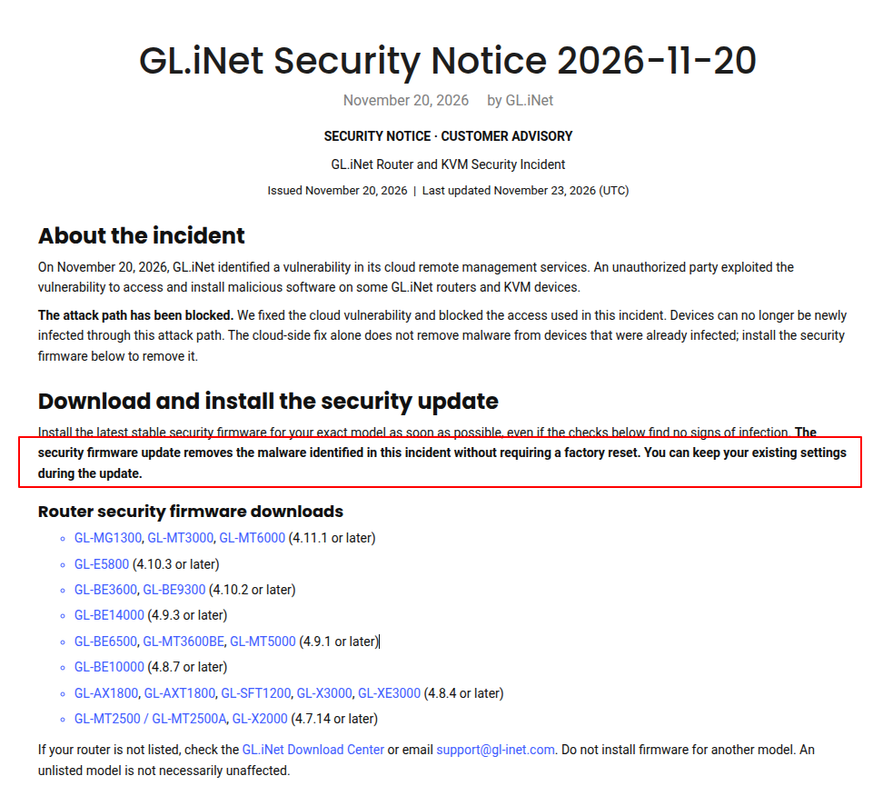

# GL.iNet's statements over time

A running record of what GL.iNet has said in public about this incident, and how it changed.
When GL.iNet changes its wording, the earlier statement stays here with its date.

The main source is GL.iNet's
[security notice](https://forum.gl-inet.com/t/2026-11-20-gl-inet-security-notice-goodcloud-kvm-routers/73056),
the first post of that forum topic. The forum shows when a post was last edited but does not
show earlier versions to the public, so this record rests on the copies we saved. Each entry
gives the forum's edit time of the version and when we saved it. The entries are our summaries;
short passages in quotation marks are GL.iNet's words. We hold the full text of each version.

The post was created on 21 November 2026 at 07:57 UTC and had been edited three times before
our first copy. We do not have those first three versions.

**From 23 November the two copies differ.** GL.iNet also publishes the notice on
[its own site](https://www.gl-inet.com/en-gb/blogs/blog/glinet-security-notice-2026-11-20). On 23 November that page was rewritten, while the forum post kept the
text of 01:53 UTC (checked at 19:06 UTC: the forum post was still at its seventh version). The
site version is recorded below as its own entry. The site shows no edit time, only "Updated
November 23, 2026 (UTC)"; the reports it links were created between 13:51 and 14:31 UTC that
day, so it was rewritten after that.

**The forum post was later brought into line with the site.** *Added 26 November 2026.* The
forum's data for the post shows version 10, last updated on 24 November 2026 at 04:04 UTC (read
by us on 26 November at 06:38 UTC). We do not hold the two versions between the seventh and that
one. Compared word by word on 26 November, ignoring formatting and links, the forum post and the
site notice differ in one place: the forum post's table of router security firmware has two
more rows. They give a minimum version of 4.5.24 for the GL-A1300 and GL-X300B, and of 4.3.31
for the GL-AP1300, GL-AR300M (NAND), GL-AR300M16, GL-AR750, GL-AR750S-EXT, GL-B1300, GL-E750 /
GL-E750V2, GL-MT1300, GL-MT300N-V2, GL-X750 and GL-XE300. The site notice still reads "Updated
November 23, 2026 (UTC)", and its text is the same as in our copy of 23 November 19:07 UTC (read
on 26 November at 06:23 UTC). One later passage on this page, on the network-storage report,
says the GL-A1300 and GL-B3000 are not in the notice's firmware list. That was written against
the text of 23 November: the GL-A1300 is now in the forum post's list, and the GL-B3000 is in
neither copy.

**Edited again on 27 November.** *Added 27 November 2026.* The forum's data shows version 11,
last updated on 27 November 2026 at 02:05 UTC (read by us at 04:44 UTC; we hold version 10 from
the day before). Compared line by line with version 10, one thing changed: the table of router
firmware. Its column is now headed "Latest stable security version" where it said "Minimum
security version", and the eight rows for the eighteen models give the second-round versions:
4.11.2 (GL-MG1300, GL-MT3000, GL-MT6000), 4.10.4 (GL-E5800), 4.10.3 (GL-BE3600, GL-BE9300), 4.9.4
(GL-BE14000), 4.9.2 (GL-BE6500, GL-MT3600BE, GL-MT5000), 4.8.8 (GL-BE10000), 4.8.5 (GL-AX1800,
GL-AXT1800, GL-SFT1200, GL-X3000, GL-XE3000) and 4.7.15 (GL-MT2500 / GL-MT2500A, GL-X2000). The
note telling GL-AXT1800 owners on 4.8.4 to contact support is gone. The two rows for older models
are unchanged. The site notice was not changed with it: at 04:44 UTC its text was still the one
of 23 November, with the first-round versions.

**The site notice rewritten again, and a message from GL.iNet's COO.** *Added 28 November 2026.*
The site notice now reads "Updated November 26, 2026 (UTC)". Our copy of 27 November at 09:00 UTC
still had the text of 23 November; our next copy, at 16:05 UTC that day, has the new one. It adds
a section on the older backdoor and gives the second-round firmware versions; see
[its entry](#site-notice-26-november-2026). The forum post was not changed with it: at 00:00 UTC on
28 November it was still version 11, without that section. On 27 November at 23:49 UTC GL.iNet's
co-founder and COO posted a message on the incident in a new forum topic; see
[its entry](#a-message-from-glinets-coo-27-november-2026). GL.iNet's site also has a security
advisories page that this record did not yet include; see
[its entry](#the-security-advisories-page).

## At a glance

| Subject | 21 Nov, 10:35 UTC | 21 Nov, 14:10 UTC | 21 Nov, 16:00 UTC | 23 Nov, 01:53 UTC | 23 Nov, site notice (read 19:07 UTC) |
|---|---|---|---|---|---|
| What owners should do | Factory reset every router and KVM, set it up again, install the firmware when released | Advice removed; two links to "quickly check" topics | Check for one process; if found, KVM beta firmware or factory reset; if not found, nothing | Install the security firmware; settings can be kept; no factory reset needed | Install the security firmware. If access is known or suspected: install it without keeping settings, set up again by hand, new passwords and keys, no restore of a backup |
| Factory reset | Recommended for all router and KVM users | Not mentioned | An option if the indicator is found; not needed otherwise | Not required, also when the indicator is found | A reset alone "does not install the security fixes"; reinstall without settings is the "strongest standard recovery" |
| How to tell if a device was hit | Contact support | Two forum topics | One indicator: a process containing `crond -i /tmp/.log` | The same indicator, and an admission that the official checks may miss affected devices | A check is optional and cannot rule out earlier access. Community script is "first choice"; the router process check is gone; the KVM quick check has "limited coverage" |
| What GL.iNet did on devices | "Implemented corrective measures … on affected devices" | The same sentence | Sentence gone | Not mentioned | The security firmware "disables the known malware" and removes its files and traces, also with settings kept; it is "not a general malware scan" |
| Does blocking the attack clean a device | Not addressed | Not addressed | No: blocking does not remove malware already installed | No; the firmware is said to remove it | No. Neither the cloud fix nor the clean-up can undo past access or revoke copied credentials |
| Fixed firmware | Being prepared | Being prepared | KVM beta now; stable for routers and KVMs on 22 November | Stable for 18 router models and 7 KVM models, with minimum versions | The same 18 router and 7 KVM models, as minimum versions |
| Community script | Not mentioned | Not mentioned | Not mentioned | Linked as an optional, unofficial check, with a disclaimer | Named first, for "broader coverage"; use check-only mode |

## Version edited 21 November 2026, 10:35 UTC

Saved by us at 12:53 UTC that day. Its own header reads "Last updated November 21, 2026, 04:25 UTC".

- A vulnerability in the cloud remote management services was exploited to install malicious
  software on "a subset" of routers and KVM devices.
- Under "What we have done": the vulnerability in the cloud services was closed; corrective
  measures were implemented "on affected devices"; an investigation was under way.
- Under "What we will do next": a firmware update "as soon as possible"; an individual email to
  everyone affected; investigation of the scope, including computers connected to affected
  KVMs.
- Not sure if your device was affected: contact support.
- **Recommended for all KVM users:** factory reset, set the device up again, check the
  connected computer, install the updated firmware when released.
- **Recommended for all router users:** factory reset, set the router up again, install the
  updated firmware when released.
- No indicator, no check, no list of models.

## Version edited 21 November 2026, 14:10 UTC

Saved by us at 15:24 UTC that day. The header still reads "04:25 UTC".

- **The factory reset recommendation for routers and KVMs is gone.** The whole "What we
  recommend" section was removed.
- In its place, under a heading about whether a device was affected: links to two forum topics,
  "Quickly check if your router is under attack" and "Quickly check if your KVM is under
  attack".
- The rest is unchanged, including the sentence about corrective measures on affected devices.

## Version edited 21 November 2026, 16:00 UTC

Saved by us at 16:41 UTC that day, and again unchanged at 07:12 UTC on 22 November. The header
reads "Last updated November 21, 2026 (UTC)". This version was rewritten throughout.

- New: "The attack path has been blocked." Devices can no longer be newly infected through it.
  These measures do not remove malware from devices already infected.
- **The sentence about corrective measures implemented on affected devices is gone.**
- New: one indicator for routers and KVMs, the exact text `crond -i /tmp/.log` in a running
  process, with the four ways to look for it that are still in the notice.
- If the indicator is found: treat the device as infected. For a KVM, install the security beta
  firmware; or restore the device to factory settings. Install the stable firmware when
  available.
- **If the indicator is not found** and there is no other reason to suspect infection: no
  factory reset or other cleanup is needed.
- If a KVM is infected, check the connected computer.
- KVM beta firmware with fixes listed for seven models (1.10.2 beta, or 1.8.6 beta for the
  RMQ1). Stable firmware for routers and KVMs scheduled for 22 November 2026.
- Notification by email to the owners GL.iNet identifies as affected.

## Version edited 23 November 2026, 01:53 UTC

Saved by us at 02:38 UTC that day. The header reads "Last updated November 23, 2026 (UTC)".
This is the version summarised in the README under "What GL.iNet has said". *Updated 25 November
2026: it was, until the README was changed on 23 November to summarise the site notice of that
day, described further down this page.*

- New section: install the latest stable security firmware for your exact model, even if the
  checks find nothing.
- **New claim:** the security firmware removes the malware identified in this incident without
  a factory reset, and existing settings can be kept during the update.

  

  *The same passage on GL.iNet's own site
  ([gl-inet.com](https://www.gl-inet.com/en-us/blogs/blog/glinet-security-notice-2026-11-20)),
  screenshot taken on 23 November 2026, not later than 05:31 UTC. The red box is ours.*
- **If the indicator is found, the factory reset option is gone.** The instruction is now to
  install the security firmware, with settings kept; contact support if the indicator is still
  there afterwards or the model is not listed.
- New: minimum fixed versions for 18 router models and 7 KVM models, and the sentence that an
  unlisted model is not necessarily unaffected.
- **New admission:** further indicators have been identified, and the official quick checks
  "may not detect every affected device". The community script is linked as an optional,
  unofficial, more comprehensive check, with a disclaimer.
- Unchanged: the indicator and the four checks; "no factory reset or other cleanup is needed"
  when the indicator is not found; the email notifications; the continuing investigation.

  

  *The "What you should do" and "How to check a GL.iNet router" passages on GL.iNet's own site,
  screenshot taken on 23 November 2026, not later than 05:32 UTC. The red box is ours.*

## Site notice, 23 November 2026 (rewritten after 14:31 UTC; read by us at 19:07 UTC)

Read at [www.gl-inet.com/en-gb/blogs/blog/glinet-security-notice-2026-11-20](https://www.gl-inet.com/en-gb/blogs/blog/glinet-security-notice-2026-11-20). Its header reads "Issued November 20, 2026 · Updated
November 23, 2026 (UTC)". We saved the page. The forum post had not been changed to match when
we read it.

What it says:

- **What happened.** Unauthorized access to some routers and KVM devices "connected to
  GoodCloud". The attack path was blocked on 20 November. The security firmware "disables the
  known malware" and removes the related files and traces identified in GL.iNet's investigation.
- **Vulnerability reports.** GL.iNet has submitted reports for the vulnerabilities it found; the
  identifiers are pending. They are listed in the next section.
- **Who is affected.** Three cases: a device that never connected to GoodCloud (not likely
  exposed); one that connected, with no evidence of access (may have been exposed: install the
  firmware and follow the precautionary password and key advice); and one that GL.iNet
  identified as affected or where access is known or suspected (follow the recovery guidance).
  Some KVMs have the cloud service enabled before an account is linked, so not having linked a
  device is not proof that it never connected.
- **Recovery, where access is known or suspected.** "For the strongest standard recovery
  assurance", download the official security firmware, install it **without keeping settings**
  and configure the device again by hand, with new passwords and keys, and without restoring a
  backup from a possibly compromised device. On routers turn "Keep Settings" off; on KVMs clear
  "Save current configuration". A factory reset alone does not install the fixes.
- **Keeping settings** "remains an option you may choose", for example to preserve remote
  access. The update still cleans up the known malware of 20 November, but "may retain other
  unauthorized changes", so it gives less assurance than a reinstall without settings.
- **Passwords and keys.** If the device connected to GoodCloud, change passwords and replace
  keys stored on or reachable from it after updating, "even if a check finds nothing". An
  update "cannot revoke a key or password that was already copied".
- **The clean-up, in its own words:** "targeted cleanup", "not a general malware scan or a
  complete integrity check".
- **Checks are optional** and cannot rule out earlier access. The community script is the first
  choice "for broader coverage". For KVMs it still points to the short forum check, with "limited
  coverage".
- **How it happened** (GL.iNet's account): GoodCloud's device-messaging service, deployed with
  EMQX, had a configuration error in message authorization, so a client could send management
  messages to other users' connected devices. Separately, an input-handling flaw in the
  AstroWarp / SD-WAN part of the router could cause management input to be run as commands with
  root rights, "even when AstroWarp was turned off".
- **Other findings it acknowledges.** The separate router persistence that forum users reported
  (the older backdoor): the reports "do not establish the initial entry path or a connection to
  this incident", and owners should not assume the clean-up resolves it. That keeping settings
  can leave other changes, citing our KVM test. That a reset or reinstall may not rewrite every
  flash region, citing our recovery section.
- **Still being determined:** the number of affected devices, the timeline of unauthorized
  activity, and whether computers connected to affected KVMs were accessed.
- **Email.** GL.iNet will email the owners of devices it identifies as affected.

Against the version of 01:53 UTC:

- **Changed.** From "you can keep your existing settings" to reinstalling without settings as
  the strongest recovery, with keeping settings as a lesser option. From "no factory reset or
  other cleanup is needed" when the indicator is absent to replacing passwords and keys for any
  device that connected to GoodCloud.
- **Removed.** The router checks for the process `crond -i /tmp/.log`: that text is no longer
  on the page. The step-by-step KVM commands, replaced by a link to the forum check.
- **Added.** The cause on the cloud side and the router side, the vulnerability reports, the
  three situations, the limits of the clean-up, the acknowledgement of the older backdoor, and
  links to community work, among them two pages of this repository.

## Site notice, 26 November 2026

*Added 28 November 2026.* Read at the same address. Its header reads "Issued November 20, 2026 ·
Updated November 26, 2026 (UTC)", and its list of changes at the end has a new line: "November 26,
2026 (UTC): Added an older malware finding and updated cleanup guidance." Our copy of 27 November
at 09:00 UTC still had the text of 23 November; the new text is in our copy of 16:05 UTC that day
and unchanged in our copy of 23:03 UTC. We hold no copy between 09:00 and 16:05 UTC. The en-gb and
en-us pages are identical, and the same text is served at the address without a language code,
which is where the banner at the top of GL.iNet's home page links (read 28 November, 00:32 UTC).

Against the site notice of 23 November:

- **Added: a section on the older backdoor.** Headed "November 26 update: Older malware reports",
  under who is affected. GL.iNet is investigating older malware found on some routers. It cites
  RemoteToHome's report of files dated as early as September 2025, and our reading that newer
  firmware builds include a clean-up for the known files. It is still checking how the malware
  reached devices and whether it is connected to the incident of 20 November. A later passage,
  "Technical background on the older malware", says the reports describe changes to the router's
  `urandom_seed` start-up script, that reported file dates "do not establish the initial infection
  date or entry point", and that our review covers the known files in the builds examined.
- **Changed: the router firmware table.** It now gives the second-round versions (4.11.2, 4.10.4,
  4.10.3, 4.9.4, 4.9.2, 4.8.8, 4.8.5 and 4.7.15, model by model as on the forum post's version 11)
  and the two rows for older models, at 4.5.24 and 4.3.31, that until now were only in the forum
  copy. The column is still headed "Minimum security version". A new sentence above the table: the
  minimum versions relate to the update of 20 November, and for the older malware owners should
  choose the latest stable firmware for their model. The note for GL-AXT1800 owners on 4.8.4 is
  gone.
- **Changed:** a device that never connected to GoodCloud "was not exposed" through this
  incident's attack path. The text of 23 November said it "was not likely exposed".
- **Removed:**
  - that some KVM devices have the cloud service enabled before an account is linked, so not
    having linked a device is not proof that it never connected, and the advice to contact support
    when unsure of a device's connection history;
  - from the passage on the separate router persistence reports: that GL.iNet acknowledged them in
    the forum, that a process name alone is not proof of infection, and "Do not assume incident
    malware cleanup resolves every separate persistence finding";
  - "(identifies pending assessment)" after the vulnerability reports, in the list of changes.
- **Reworded:** the passage on flash regions that a reset or reinstall may not rewrite, which cites
  this repository, is now headed "If problems continue after reinstalling" and says this "does not
  mean those areas were changed during the attack". It was headed "Firmware and boot integrity".
- **Links to this repository:** six, to five places, where the text of 23 November had two. The
  text "RemoteToHome reports files dated as early as September 2025" links to
  [What has been found beyond that](../README.md#what-has-been-found-beyond-that); "Newer firmware
  builds it reviewed include cleanup for the known files" and "firmware cleanup review" link to
  [Fixed firmware](../README.md#fixed-firmware); "RemoteToHome's analysis" links to
  [the older backdoor's loader](older-backdoor-loader.md); the KVM and flash-region passages link,
  as before, to [the KVM firmware page](kvm-firmware.md) and to
  [If you find something](../README.md#if-you-find-something).

Points we note:

- The forum post and the site notice differ again. At 00:00 UTC on 28 November the forum post was
  still at version 11, of 27 November 02:05 UTC, without the section on the older backdoor, and it
  still carried the sentences the site dropped, among them "Do not assume incident malware cleanup
  resolves every separate persistence finding" and the one saying some KVMs have the cloud service
  enabled before an account is linked.
- The passage removed on KVMs matches our own reading of the GL-RM1 1.10.2 image: a new or
  reinstalled unit has the cloud service switched on (README, under
  [Reducing exposure](../README.md#reducing-exposure-until-fixed-firmware-is-installed)).

## A message from GL.iNet's COO, 27 November 2026

*Added 28 November 2026.* A new forum topic,
[A Message from GL.iNet COO about the secuirty incident](https://forum.gl-inet.com/t/a-message-from-gl-inet-coo-about-the-secuirty-incident/73365)
(its spelling), opened on 27 November 2026 at 23:49 UTC by the staff account alzhao and edited
once, at 23:52 UTC. We hold the edited version, read on 28 November at 00:32 UTC. It is signed
Alfie Zhao, who introduces himself as the co-founder and COO of GL.iNet.

According to the subreddit's moderators, the same message was posted in r/GlInet by the moderator
u/wickedwarlock84, signed by Alfie Zhao, and the COO's own Reddit account is u/Alfie_GLiNet
(Reported; we have not read the Reddit post directly). We compared a copy of that post with the
forum post: the text is the same apart from the sign-off and a closing link to the forum topic.

What it says:

- **Responsibility.** He takes responsibility for "the slow and incomplete communication". The
  advisory should have been quick, clean and understandable; when the community found more,
  GL.iNet made it feel that information was being withheld.
- **Investigation.** GL.iNet is engaging an outside legal and forensic team to investigate the
  incident, "including the questions raised about our earlier activity".
- **Audit.** A professional security firm has been brought in to audit GL.iNet's firmware, cloud
  services and source code, including "the additional OpenWrt code".
- **A report.** Once the full scope is known, a fact-checked report with the full findings will be
  published. No date is given.
- **Where official updates will appear:** first as an ongoing announcement at the top of
  GL.iNet's home page, second in the forum topic of the notice, and in a new newsletter for
  security updates. Security reports go to security@gl-inet.com.
- **The older attack.** GL.iNet will work over the weekend to learn more about "the older
  attack".
- **Longer term:** a common firmware base, so that a security fix is built once and reaches every
  model.
- **Thanks.** It thanks community members by their Reddit names, among them RemoteToHome, and
  says that some of the people who have helped are GL.iNet employees.

On 28 November at 00:24 UTC the same account answered a user in that topic: "Definitely will get
new guys in security team and enhance security."

Points we note:

- The message gives no date for the report and does not state the number of devices, the time
  window, or how the older backdoor was installed. Those remain open; see
  [What the notice has not said](#what-the-notice-has-not-said-in-any-version-we-hold).
- At the top of GL.iNet's home page, when we read it on 28 November at 00:32 UTC, was a link
  reading "Security Notice: GoodCloud Remote Management Incident" to the site notice.

## GL.iNet's published vulnerability reports

GL.iNet keeps vulnerability reports in a public repository, [gl-inet/CVE-issues](https://github.com/gl-inet/CVE-issues). We read
it on 23 November 2026 at 19:08 UTC and again at 20:30 UTC. The dates below are the dates of the commits that added
each file; we do not know when the repository itself became public.

Created on 23 November 2026, and linked from the site notice:

| Report | Added (UTC) | What GL.iNet states |
|---|---|---|
| [EMQX authorization bypass leading to remote code execution](https://github.com/gl-inet/CVE-issues/blob/main/GoodCloud/EMQX%20Authorization%20Bypass%20Leading%20to%20Remote%20Code%20Execution.md) | 13:51, updated 14:08 | Through an EMQX misconfiguration, an attacker "who knows another device's MAC address" can send forged MQTT messages to that device's topics: push configuration, change device information, call the functions the device exposes to the cloud. Affected: GoodCloud v3.19.13; fixed in v3.19.14. Constraint: the attacker must control at least one GL.iNet device, and can only reach other devices that are connected to it. *Clarified 26 November 2026: "it" is GoodCloud, not the attacker's device. GL.iNet's words: "An attacker can only launch attacks from a GL device connected to GoodCloud against other users' GL devices that are also connected to GoodCloud." The report also says device MAC addresses can be enumerated "in bulk".* |
| [AstroWarp (SD-WAN) command injection via the `virtual_ip_info` field](https://github.com/gl-inet/CVE-issues/blob/main/4.0.0/AstroWarp(SDWAN)%20API%20Command%20Injection%20via%20thevirtual_ip_info%20Field%20Allows%20Arbitrary%20Command%20Execution%20as%20Root.md) | 14:31 | The function does not validate the IP field or check whether the feature is enabled; a malicious value is put into a shell command and run as root, also when the feature is disabled. Eighteen router models, one affected version each (for example GL-MT3000 4.11.0, GL-AXT1800 4.8.3), with the "expected fix" version |
| [Root access via rtty configuration modification and TLS certificate verification bypass](https://github.com/gl-inet/CVE-issues/blob/main/common/Root%20Access%20via%20Rtty%20Configuration%20Modification%20and%20TLS%20Certificate%20Verification%20Bypass.md) | 14:20 | Certificate checking in the remote-terminal client can be bypassed by changing the arguments of its start command, so a device can be made to connect to a hostile terminal server, which gets root. All seven KVM models (fixed in 1.10.3 and 1.8.7) and 31 router models, including older ones on the 4.3 and 4.5 firmware lines, most with an "expected fix" version |

Added on 15 and 16 October 2026, five weeks before the attack:

| Report | Added (UTC) | What GL.iNet states |
|---|---|---|
| [Improper access control in glkvm-cloud](https://github.com/gl-inet/CVE-issues/blob/main/KVM/cloud/Improper%20access%20control%20in%20glkvm-cloud%20enables%20cross-tenant%20device%20takeover%2C%20credential%20disclosure%2C%20and%20unauthenticated%20device%20control.md) | 15 October, 04:23 | In the KVM cloud service (v2.8.0, and the main branch as of September 2026) the device-control paths check that a user is logged in but not that the device belongs to that user: any logged-in user could open another tenant's KVM session, run commands on its agent and reach services on its network. A further path disclosed device connection credentials |
| [Argument injection in the `S99rtty` start-up script](https://github.com/gl-inet/CVE-issues/blob/main/KVM/RM1/Argument%20injection%20in%20S99rtty%20startup%20script%20enables%20unauthenticated%20root%20terminal%20on%20GLKVM%20RM1.md) | 16 October, 03:39 | GL-RM1 firmware V1.10.1: the script built the remote-terminal command from configuration delivered by the cloud without quoting it, so a crafted server entry could add `-f root` and open a root terminal without a login |
| [TLS certificate host name not verified in the cloud agent](https://github.com/gl-inet/CVE-issues/blob/main/KVM/RM1/Improper%20TLS%20certificate%20hostname%20verification%20in%20gl-cloud%20agent%20enables%20cloud%20service%20impersonation%20on%20GLKVM%20RM1.md) | 16 October, 03:39 | GL-RM1 V1.10.1: the cloud agent checked the certificate chain but not the name, so anyone on the network path with any valid public certificate could pose as the cloud |
| [Certificate authorities downloaded at run time](https://github.com/gl-inet/CVE-issues/blob/main/KVM/RM1/Runtime-downloaded%20CA%20certificates%20allow%20TLS%20trust%20root%20replacement%20on%20GLKVM%20RM1.md) | 16 October, 03:39 | GL-RM1 V1.10.1: the authorities used for the message broker and the remote terminal were downloaded (for example from `/getCaCert/ca.crt`) and trusted with no check, so the trust root could be replaced |

Other reports added to the same repository since mid-October. The site notice, as we read it at
19:07 UTC, does not link any of these, and GL.iNet has not connected them to the incident. We
read them on 23 November 2026 at 20:30 UTC:

| Report | Added (UTC) | What GL.iNet states |
|---|---|---|
| [Login timestamp enumeration allows authentication bypass in `gl_nas_sys`](https://github.com/gl-inet/CVE-issues/blob/main/4.0.0/Login%20Timestamp%20Enumeration%20Allows%20Authentication%20Bypass%20in%20GL.iNet%20gl_nas_sys.md) | 23 November, 18:27 | The router's network-storage service runs as root. Its session token is the MD5 digest of the login time in whole seconds. Someone with access to the router's internal network who can estimate when a user logged in to network storage through the mobile app can try nearby times, and, while that session is still held, act as that user on the storage management functions: list, add, delete and change storage users. No login is needed. Twenty router models are listed. For the GL-MG1300, GL-MT6000 and GL-MT3000 it is "already fixed in 4.11.1"; for the other seventeen an "expected fix" version is given. For thirteen of those it is the version of the model's security firmware. The four exceptions: GL-MT2500 (4.7.5; the security firmware is 4.7.14), GL-A1300 and GL-B3000 (4.5.24; neither model is in the notice's security firmware list), and GL-BE14000 (4.9.3 affected, expected fix 4.9.4). |
| [HTTP response header injection and response splitting via download filename on GL-MT3000](https://github.com/gl-inet/CVE-issues/blob/main/4.0.0/HTTP%20response%20header%20injection%20and%20response%20splitting%20via%20download%20filename%20on%20GL-MT3000.md) | 19 October, 02:34 | GL-MT3000 4.9.0 (build of 2 September 2026). A logged-in user of the download function can put extra headers into the router's reply through the file name. Shown by the reporter in an emulated system, not on a device. It does not get around the login. |
| [Insufficient input validation in WireGuard client configuration on GL-MT3000](https://github.com/gl-inet/CVE-issues/blob/main/4.0.0/Insufficient%20input%20validation%20in%20WireGuard%20client%20configuration%20on%20GL-MT3000.md) | 19 October, 02:34 | GL-MT3000 4.9.0. A logged-in user can store line breaks and shell characters in the WireGuard client settings file. GL.iNet calls this "a review draft, not a confirmed remote code execution advisory": no place where the stored text is run has been shown. |
| [Insufficient path validation in the default RPC validator on GL-MT3000](https://github.com/gl-inet/CVE-issues/blob/main/4.0.0/Insufficient%20path%20validation%20in%20the%20default%20RPC%20validator%20on%20GL-MT3000.md) | 19 October, 02:34 | GL-MT3000 4.9.0. The web interface's default check on a field accepts `../`. GL.iNet calls this "a review draft pending evidence": no access to a file outside the permitted folder has been shown. A login is assumed. |

Points we note, from our own data:

- The router report names one affected version per model. We found the same code from
  GL-MT3000 4.7.0, released 5 December 2024, onward
  ([technical breakdown](technical-breakdown.md#history-where-the-code-came-from)).
- That report gives 4.7.5 as the expected fix for the GL-MT2500; the notice and the firmware
  listing give 4.7.14.
- The cloud report says the attacker addresses a device by its hardware address. The messages
  we recovered carry the router's identifier in exactly that form, twelve hexadecimal
  characters ([attacker messages](attacker-messages.md)).
- Our test RM1 was running V1.10.1 on 21 November 2026, and the 1.10.2 images are dated
  21 November. So the three RM1 reports of 16 October describe the firmware that was in use
  when the attack happened.
- The network-storage report gives 4.9.4 as the expected fix for the GL-BE14000. The security
  firmware GL.iNet lists for that model is 4.9.3, which the report names as affected. Going by
  GL.iNet's own report, a GL-BE14000 on the security firmware still has that flaw. We have not
  tested the network-storage flaw or its fix on any device.
- The WireGuard report concerns the WireGuard client settings. It is not the WireGuard server
  settings file that changed on routers in our data, and we know of no link between the two.

### The security advisories page

*Added 28 November 2026.* GL.iNet's site has a
[Security Updates](https://www.gl-inet.com/blogs/security-updates) blog. When we read it on
28 November at 00:33 UTC it listed eight advisories, each with a release date: the newest, dated
24/11/2026,
[Security Advisories (Vulnerabilities and CVEs) Nov 24 2026](https://www.gl-inet.com/blogs/security-updates/security-advisories-vulnerabilities-and-cves-nov-24-2026),
and seven earlier ones, dated from 01/12/2022 to 15/04/2026. The newest page's own data gives
23 November 2026, 19:00 at UTC−5 (00:00 UTC on 24 November) as both its publication and its
modification time. Yet it names firmware 4.11.3, which GL.iNet released on 27 November (our mirror
held it by 13:27 UTC that day): either the page was changed after its stated time, or it named a
version not yet released. This is our first copy, so we do not know what it said before.

What it states:

- Four reports, each with an identifier of the form `vdb-submit-<number>` and a summary matching
  the title of one of the reports above: `vdb-submit-1112985`, the EMQX authorization bypass; `vdb-submit-1112986`,
  the remote-terminal configuration and certificate check; `vdb-submit-1112997`, the AstroWarp
  command injection through `virtual_ip_info`, credited to Xusheng Li; `vdb-submit-1113491`, the
  login timestamp enumeration in `gl_nas_sys`. The page gives no CVE number. The site notice says
  that report titles and internal tracking references are not CVE numbers.
- Affected and resolved firmware, one table for routers and one for KVMs:

  | Models | Affected | Resolved |
  |---|---|---|
  | GL-MT3000, GL-MT6000 | 4.11.0 and earlier | 4.11.3 |
  | GL-MG1300 | 4.10.1 and earlier | 4.11.2 |
  | GL-E5800 | 4.10.2 and earlier | 4.10.4 |
  | GL-BE3600, GL-BE9300 | 4.10.1 and earlier | 4.10.3 |
  | GL-BE14000 | 4.9.2 and earlier | 4.9.4 |
  | GL-BE6500, GL-MT3600BE, GL-MT5000 | 4.9.0 and earlier | 4.9.2 |
  | GL-BE10000 | 4.8.6 and earlier | 4.8.8 |
  | GL-AX1800, GL-SFT1200, GL-X3000, GL-XE3000, GL-AXT1800 | 4.8.3 and earlier | 4.8.5 |
  | GL-MT2500 / GL-MT2500A | 4.7.4 and earlier | 4.7.15 |
  | GL-X2000 | 4.7.13 and earlier | 4.7.15 |
  | GL-A1300, GL-X300B | 4.5.22 and earlier | 4.5.24 |
  | GL-AR300M, GL-AR300M16, GL-E750 / GL-E750V2, GL-MT300N-V2, GL-XE300 | 4.3.30 and earlier | 4.3.31 |
  | GL-AR750, GL-AR750S-EXT, GL-B1300, GL-MT1300, GL-X750 | 4.3.25 and earlier | 4.3.31 |
  | GL-AP1300 | 4.3.18 and earlier | 4.3.31 |
  | KVMs RM1, RM1V2, RM10, RM10RC, RM1PE, RM4PE | 1.10.1 and earlier | 1.10.3 |
  | KVM RMQ1 | 1.8.5 and earlier | 1.8.7 |

- Security bugs are to be reported to security@gl-inet.com, and GL.iNet states "a 90-day policy for
  vulnerability disclosure".

Points we note:

- **For the GL-MT3000 and GL-MT6000 the resolved version is 4.11.3,** one step above the 4.11.2 that
  the site notice gives as their minimum security version and the forum notice as their latest
  stable security version. GL.iNet released 4.11.3 for both models on 27 November. Its release
  note lists two fixes, for Mesh logs that could fill `/tmp` and for opening the AdGuard Home
  settings page over HTTPS, and says nothing about security. We have not read the 4.11.3 builds.
- **For the GL-MT2500 the page gives "4.7.4 and earlier" as affected.** In our field survey,
  GL-MT2500 routers found on 4.7.13 and on 4.9.0 showed that the attacker's command of 20 November
  had run on them ([field survey](field-survey.md)). If they were on those versions when it
  arrived, the AstroWarp flaw was present after 4.7.4. The table does not say which of the four
  reports each row refers to.

## GL.iNet staff posts in the forum

This section records, in time order, what GL.iNet staff said about the incident in the public forum
at https://forum.gl-inet.com . It is a companion to the record of the security notice itself. Only
forum posts are included; nothing from private messages or support emails. "Staff" means a member of
the forum group `GL.iNet_Staff`: **AdamK, alzhao, bruce, charles2, robotluo, snowisland, Thalia,
will.qiu**. Summaries are neutral; short quoted phrases (under 15 words) are in quotation marks.
Times are UTC.

*Added 26 November 2026.* "Staff" here is the forum's own label, not our inference. Each of the
eight accounts carries the forum's title "GL.iNet Staff" and has `GL.iNet_Staff` as its primary
group in its public profile data (`https://forum.gl-inet.com/u/<username>.json`, fields `title`
and `primary_group_name`; we read all eight on 26 November 2026 at 06:31 UTC). The account
**admon** carries neither. In this section people are named only by their public forum
usernames.

AdamK is in the staff group; some of his posts go further than the official notice. They are
listed as posted. The community researcher who posts as **admon** is a volunteer moderator, not
GL.iNet staff, and is not listed here.

| UTC time | Staff | What was said | Post |
|---|---|---|---|
| 2026-11-21 12:33:03 | snowisland | First KVM security firmware (1.10.2): "enhances the security of the Cloud Computing Platform's remote management service"; beta links. | [73058/5](https://forum.gl-inet.com/t/kvm-safety-release-1-10-2-release1/73058/5) |
| 2026-11-21 12:48:24 | will.qiu | The KVM fixed firmware was first shared via Google Drive; now in the Download Center, so that thread was unlisted. | [73056/30](https://forum.gl-inet.com/t/2026-11-20-gl-inet-security-notice-goodcloud-kvm-routers/73056/30) |
| 2026-11-21 14:05:11 | robotluo | Links the two quick-check threads: KVM and router. | [73056/37](https://forum.gl-inet.com/t/2026-11-20-gl-inet-security-notice-goodcloud-kvm-routers/73056/37) |
| 2026-11-21 14:28–14:54 | bruce | To several users, their `ps \| grep tmp` output is "safe" / "healthy" / "not compromised". | [73070/5](https://forum.gl-inet.com/t/quickly-check-if-your-router-is-under-attack/73070/5) |
| 2026-11-21 15:17:00 | alzhao | To a vanilla-OpenWrt GL-MT6000 user: "Not affected." | [73070/17](https://forum.gl-inet.com/t/quickly-check-if-your-router-is-under-attack/73070/17) |
| 2026-11-21 15:20:10 | AdamK | `ps \| grep tmp` is "simply a point-in-time check"; does not show prior compromise or on-disk persistence. | [73070/19](https://forum.gl-inet.com/t/quickly-check-if-your-router-is-under-attack/73070/19) |
| 2026-11-21 15:40:13 | alzhao | To a user: "Seems that you are under attack. We received your email and will contact you there." | [73070/25](https://forum.gl-inet.com/t/quickly-check-if-your-router-is-under-attack/73070/25) |
| 2026-11-21 16:00:14 | bruce | "The original post has been updated, please check the latest updates" (link to the notice). | [73056/52](https://forum.gl-inet.com/t/2026-11-20-gl-inet-security-notice-goodcloud-kvm-routers/73056/52) |
| 2026-11-21 16:11–16:13 | AdamK | Adds reverse-shell checks: `netstat -tnp \| grep '170.39.226.219'`, process hunts; a negative quick check "is not sufficient". | [73070/32](https://forum.gl-inet.com/t/quickly-check-if-your-router-is-under-attack/73070/32) |
| 2026-11-21 16:27:11 | alzhao | Warns `netstat` "can be compromised and running it will start the malware"; shows the healthy case `/bin/netstat -> busybox`. | [73070/41](https://forum.gl-inet.com/t/quickly-check-if-your-router-is-under-attack/73070/41) |
| 2026-11-21 16:37:18 | AdamK | `/tmp` is in RAM, so its contents are lost on reboot; check and preserve evidence before rebooting. | [73070/43](https://forum.gl-inet.com/t/quickly-check-if-your-router-is-under-attack/73070/43) |
| 2026-11-21 17:15:06 | AdamK | "CONFIRMED. An anonymous report of infected data shows netstat was hijacked." | [73070/48](https://forum.gl-inet.com/t/quickly-check-if-your-router-is-under-attack/73070/48) |
| 2026-11-21 18:54:06 | AdamK | "We're currently working on a standardized support response"; the community tool is the best check for now; a clean result cannot rule out prior compromise. | [73070/57](https://forum.gl-inet.com/t/quickly-check-if-your-router-is-under-attack/73070/57) |
| 2026-11-21 20:21:51 | AdamK | Recommends NOT keeping the configuration when upgrading a compromised device; upgraded his infected RM10 and the four `gl-helper` files and the `rc.local` entry "are now gone". | [73069/5](https://forum.gl-inet.com/t/quickly-check-if-your-kvm-is-under-attack/73069/5) |
| 2026-11-22 00:24:52 | AdamK | The key factor is whether GoodCloud was connected when the commands arrived; lists models/firmware with reported indicators and dashboard counts (612 submissions, 482 deduped, 145 with traces); "not a definitive list". | [73070/55](https://forum.gl-inet.com/t/quickly-check-if-your-router-is-under-attack/73070/55) |
| 2026-11-22 00:38:48 | AdamK | A modified `rc.local` alone is not proof of malware; the script flags files that differ from a baseline. | [73069/8](https://forum.gl-inet.com/t/quickly-check-if-your-kvm-is-under-attack/73069/8) |
| 2026-11-22 01:16:43 | robotluo | "Upgrading without retaining the configuration will unbind the account; therefore, you will need to rebind it." | [73069/9](https://forum.gl-inet.com/t/quickly-check-if-your-kvm-is-under-attack/73069/9) |
| 2026-11-22 01:23:26 | AdamK | After removing a device from GoodCloud it reconnected until GoodCloud was disabled locally; asks whether removal revokes authorization. | [73069/10](https://forum.gl-inet.com/t/quickly-check-if-your-kvm-is-under-attack/73069/10) |
| 2026-11-22 06:23–06:45 | charles2 | To several users: if the notice indicator is absent and nothing else is unusual, no factory reset is needed; install the stable security update when available. | [73057/13](https://forum.gl-inet.com/t/regarding-the-security-notice/73057/13) |
| 2026-11-22 07:15–09:09 | charles2 | Same guidance in the router thread (Flint 2 and others); links the community diagnostic. | [73070/76](https://forum.gl-inet.com/t/quickly-check-if-your-router-is-under-attack/73070/76) |
| 2026-11-22 08:11:37 | charles2 | GL has found three cases: the `gl-helper` implant with the `crond -i /tmp/.log` indicator; a GL-AXT1800 shell to `170.39.226.219`; an older backdoor changing `urandom_seed` with `monitord`/`ujaild`. | [73056/108](https://forum.gl-inet.com/t/2026-11-20-gl-inet-security-notice-goodcloud-kvm-routers/73056/108) |
| 2026-11-22 11:58:01 | charles2 | Thanks a user who sent a report and screenshots to the security and support teams; asks to keep the same email thread. | [73070/95](https://forum.gl-inet.com/t/quickly-check-if-your-router-is-under-attack/73070/95) |
| 2026-11-22 12:33:13 | charles2 | To a Mudi 7 owner: "a factory reset should be sufficient"; "your router won't be reinfected through that path after the reset." | [73070/99](https://forum.gl-inet.com/t/quickly-check-if-your-router-is-under-attack/73070/99) |
| 2026-11-22 13:03:22 | charles2 | How to find whether a router is bound and online in GoodCloud; asks for a read-only `ps` output and the log by private message. | [73070/109](https://forum.gl-inet.com/t/quickly-check-if-your-router-is-under-attack/73070/109) |
| 2026-11-22 15:53:40 | snowisland | How to read a KVM's model/revision; the latest online KVM version is deployed, upgrade via the red dot. | [73058/7](https://forum.gl-inet.com/t/kvm-safety-release-1-10-2-release1/73058/7) |
| 2026-11-23 01:53:59 | bruce | The current security notice: "The attack path has been blocked"; the security firmware "removes the malware ... without requiring a factory reset"; per-model minimum versions; indicator `crond -i /tmp/.log`. | [73056/1](https://forum.gl-inet.com/t/2026-11-20-gl-inet-security-notice-goodcloud-kvm-routers/73056/1) |
| 2026-11-23 02:10:50 | bruce | "We have updated the firmware for most models"; the rest "will continue to be released incrementally over the coming days". | [73056/158](https://forum.gl-inet.com/t/2026-11-20-gl-inet-security-notice-goodcloud-kvm-routers/73056/158) |
| 2026-11-23 03:09:32 | Thalia | To an RM10 owner with odd outbound traffic: GL "recently discovered some security issues"; run the KVM check, update, and "perform a complete security scan on the Windows computer connected to the RM10". | [73030/3](https://forum.gl-inet.com/t/gl-rm10-causing-recurring-x11-connection-warnings-in-mobaxterm/73030/3) |
| 2026-11-23 03:13:58 | will.qiu | On 4.7+ with GoodCloud remote web access on, you can export a backup remotely through LuCI (port 8080); reposts the firmware list. | [73062/2](https://forum.gl-inet.com/t/script-upgrade-firmware-with-backup-locally-or-remotely/73062/2) |
| 2026-11-23 06:57:22 | will.qiu | The empty LuCI "Status → Processes" page on a GL-BE9300 "is expected with the current QSDK and LuCI combination"; points to the SSH check instead. | [73166/4](https://forum.gl-inet.com/t/be9300-luci-no-info-in-status-processes/73166/4) |
| 2026-11-23 07:06:26 | will.qiu | On fixes for older devices: "we're working on this, and expect to release it in about 2–3 days." | [73056/168](https://forum.gl-inet.com/t/2026-11-20-gl-inet-security-notice-goodcloud-kvm-routers/73056/168) |
| 2026-11-23 08:58:16 | charles2 | A router "needs to connect to GoodCloud to obtain its DPI license and ... signature database"; you can use DPI "without binding your router to a GoodCloud account". *Corrected 28 November 2026: this row named will.qiu; the post is by charles2.* | [73090/7](https://forum.gl-inet.com/t/router-features-going-forward-after-the-remote-exploit/73090/7) |
| 2026-11-23 09:18:18 | will.qiu | On the GoodCloud risk: VPN failover "is already supported locally on the router, independently of GoodCloud"; the Flint 3 security fix "is available in v4.10.2". | [73065/4](https://forum.gl-inet.com/t/critical-feedback-goodcloud-risk-vpn-auto-failover-ui-regressions-forced-dns-and-pppoe-drops/73065/4) |
| 2026-11-23 09:27:51 | will.qiu | GL-X3000 v4.8.4 stable has the GoodCloud security fix (without SQM); a v4.11 stable with both is expected soon. | [73089/3](https://forum.gl-inet.com/t/spitz-ax-gl-x3000-goodcloud-security-patch-for-sqm-beta-firmware/73089/3) |
| 2026-11-23 09:29:33 | bruce | To a thread about other malware found while looking for 20 November evidence: "We have received this issue and are currently verifying it." | [73097/42](https://forum.gl-inet.com/t/found-other-malware-while-looking-for-11-20-evidence/73097/42) |
| 2026-11-24 07:11:23 | bruce | To a user asking if GoodCloud is safe to use again after a clean flash: the attacks "have ceased" and the vulnerability has been patched; GoodCloud and devices on the latest firmware are secure and operating normally; links the fix page, suggests the community script, and asks for anomalies to go to support (edited 07:16:57). | [73056/197](https://forum.gl-inet.com/t/2026-11-20-gl-inet-security-notice-goodcloud-kvm-routers/73056/197) |
| 2026-11-24 07:13:04 | bruce | Devices that never had GoodCloud enabled are unaffected and unrelated to the incident; the current cloud-to-device connection is secure; same fix-page link and support address (edited 07:16:47). | [73056/198](https://forum.gl-inet.com/t/2026-11-20-gl-inet-security-notice-goodcloud-kvm-routers/73056/198) |
| 2026-11-24 07:43:14 | will.qiu | To a GL-MT2500A owner whose unit stopped connecting: if it never connected to GoodCloud it "should not be affected"; it looks more like a bricked device; links the debrick guide; contact support if under warranty. | [73056/199](https://forum.gl-inet.com/t/2026-11-20-gl-inet-security-notice-goodcloud-kvm-routers/73056/199) |
| 2026-11-24 07:48:48 | will.qiu | To a user quoting the AstroWarp/SD-WAN report: the AstroWarp report means the flaw does not need AstroWarp enabled, but the exploit path "still needs to go through the GoodCloud". | [73056/200](https://forum.gl-inet.com/t/2026-11-20-gl-inet-security-notice-goodcloud-kvm-routers/73056/200) |
| 2026-11-24 10:04:48 | bruce | To a user asking how to have an AstroWarp/GoodCloud account erased: delete it from the cloud platform, or send the request to support (edited 10:05:51). | [73056/206](https://forum.gl-inet.com/t/2026-11-20-gl-inet-security-notice-goodcloud-kvm-routers/73056/206) |
| 2026-11-24 10:07:07 | bruce | To a user asking whether stopping GoodCloud on the router would stop DPI database updates: DPI updates "will not be affected"; DPI does not require a cloud account to be linked. | [73056/208](https://forum.gl-inet.com/t/2026-11-20-gl-inet-security-notice-goodcloud-kvm-routers/73056/208) |
| 2026-11-24 10:40:42 | bruce | To a user doubting the "patched" statement: GL.iNet can confirm the vulnerability related to this incident has been patched; quotes the notice's bullet on separate router persistence reports; says R&D has worked "in 24-hour rotational shifts". | [73056/209](https://forum.gl-inet.com/t/2026-11-20-gl-inet-security-notice-goodcloud-kvm-routers/73056/209) |
| 2026-11-24 11:05:07 | bruce | To a user asking about round-the-clock monitoring and malware age: "We are investigating this incident"; no details can be shared publicly now; more information will follow as the investigation progresses. | [73056/212](https://forum.gl-inet.com/t/2026-11-20-gl-inet-security-notice-goodcloud-kvm-routers/73056/212) |
| 2026-11-24 14:33:27 | bruce | To a user noting that the clean-up put `urandom_seed` back but left `/bin/ulogd`: the question is under investigation; the issue within the scope of the official announcement is resolved in this firmware update; a CVE in the follow-up will distinguish the incident (edited 14:34:14). | [73056/216](https://forum.gl-inet.com/t/2026-11-20-gl-inet-security-notice-goodcloud-kvm-routers/73056/216) |
| 2026-11-25 08:54:55 | snowisland | The user wrote that they run 1.11.3 beta, that GoodCloud is not running, and that the device appears infected. Staff replied that 1.11.0 beta3 was shared a day before the KVM vulnerability was found and addressed, so use 1.10.3 release1 first; the 1.11 release will get the fixes later; for other KVM models, the patched versions are in a table image (not read) (edited 08:57:56). | [73070/134](https://forum.gl-inet.com/t/quickly-check-if-your-router-is-under-attack/73070/134) |
| 2026-11-25 09:34:53 | charles2 | To a user who reported GoodCloud still running after unbinding and restarting: GL tested a GL-MT6000 on 4.11.2 and the process stopped after unbinding; asks for model, firmware and where it was unbound; gives the Disable steps per firmware branch and asks for a retest on the latest stable firmware (edited 09:39:03). | [73070/136](https://forum.gl-inet.com/t/quickly-check-if-your-router-is-under-attack/73070/136) |
| 2026-11-25 09:37:36 | bruce | To a DPI question: DPI database updates use "a different connection method from GoodCloud"; if GoodCloud was never enabled, the incident does not affect the device. | [73056/237](https://forum.gl-inet.com/t/2026-11-20-gl-inet-security-notice-goodcloud-kvm-routers/73056/237) |
| 2026-11-25 10:05:54 | bruce | To a Spitz AX complaint about frequent fixes and no updates for over a year: apologises; says frequent releases reflect efforts on device security; says fixes for vulnerabilities in GL's MTK SDK were applied on OpenWrt 21; asks for samples and verification steps for further issues. | [73056/238](https://forum.gl-inet.com/t/2026-11-20-gl-inet-security-notice-goodcloud-kvm-routers/73056/238) |
| 2026-11-25 10:38:46 | bruce | Upgrade quick guide (online and manual): leave "Keep settings" unchecked "if necessary"; after the upgrade, configure the device as new and do not import a previous backup; download the model's own firmware, no cross-flashing (edited 10:43:29). | [73056/239](https://forum.gl-inet.com/t/2026-11-20-gl-inet-security-notice-goodcloud-kvm-routers/73056/239) |
| 2026-11-25 10:48:58 | bruce | To an X2000 owner whose laptop dropped off Wi-Fi after the flash: asks whether other devices connect; if so, forget the saved network on the laptop and reconnect. | [73056/240](https://forum.gl-inet.com/t/2026-11-20-gl-inet-security-notice-goodcloud-kvm-routers/73056/240) |
| 2026-11-25 11:56:49 | bruce | To a Brume 3 owner who lost access to the router page: asks about the network layout and drop-in gateway mode; suggests giving the Brume 3 a different gateway address. | [73056/241](https://forum.gl-inet.com/t/2026-11-20-gl-inet-security-notice-goodcloud-kvm-routers/73056/241) |
| 2026-11-26 01:58:17 | will.qiu | To a request to update the Tailscale version shipped in GL firmware: "Thank you for the reminder. We are working on it." | [73056/254](https://forum.gl-inet.com/t/2026-11-20-gl-inet-security-notice-goodcloud-kvm-routers/73056/254) |
| 2026-11-26 03:09:50 | will.qiu | Explains the security updates are built on existing stable firmware because a targeted fix needs less development and testing than moving v4.5 to v4.7-v4.11; says maintenance work (new firmware for MT300N-V2, AR300M, E750) began before the incident, and new team members have been hired. | [73056/255](https://forum.gl-inet.com/t/2026-11-20-gl-inet-security-notice-goodcloud-kvm-routers/73056/255) |
| 2026-11-26 03:12:52 | will.qiu | To a Flint 4 owner who got an indicator hit, flashed the first security firmware without settings and the second with settings, and deleted the cloud account: "Yes, you can leave it as it is"; the first firmware without keeping settings should have removed the known malware; keeping settings on the next upgrade is fine. | [73056/256](https://forum.gl-inet.com/t/2026-11-20-gl-inet-security-notice-goodcloud-kvm-routers/73056/256) |
| 2026-11-26 03:16:05 | will.qiu | To a Brume 3 owner without web ports 80/443 after an upgrade: asks for the system logs by private message and the output of `nginx -t` and `nginx` over SSH. | [73056/257](https://forum.gl-inet.com/t/2026-11-20-gl-inet-security-notice-goodcloud-kvm-routers/73056/257) |
| 2026-11-26 09:15:07 | will.qiu | To a user asking about a `stubby` account and `netifyd` on an MT5000: after an upgrade past v4.9 that keeps settings, the `stubby` account staying in `/etc/passwd` is normal (older firmware used it for DNS over TLS, shell `/bin/false`); `netifyd` is not in the base image under `/rom` and is installed separately when DPI features are enabled. | [73070/147](https://forum.gl-inet.com/t/quickly-check-if-your-router-is-under-attack/73070/147) |
| 2026-11-27 16:16:18 | alzhao | To a user who said the remote-terminal component (rtty) was what was affected: "We will get this beast under control." | [73056/278](https://forum.gl-inet.com/t/2026-11-20-gl-inet-security-notice-goodcloud-kvm-routers/73056/278) |
| 2026-11-27 16:17:00 | alzhao | To a user who said GL.iNet should not ship closed-source firmware: the source code will be audited by a security audit firm (the post says "security audit firmware"). | [73056/279](https://forum.gl-inet.com/t/2026-11-20-gl-inet-security-notice-goodcloud-kvm-routers/73056/279) |
| 2026-11-27 23:49:34 | alzhao | Opens a new topic with a message signed by Alfie Zhao, co-founder and COO: takes responsibility for the communication; outside legal and forensic team; security audit; a report to follow. See [its entry](#a-message-from-glinets-coo-27-november-2026). Edited 23:52 UTC. | [73365/1](https://forum.gl-inet.com/t/a-message-from-gl-inet-coo-about-the-secuirty-incident/73365) |
| 2026-11-28 00:24:14 | alzhao | To a user who said even a large team struggles to keep such software safe: "Definitely will get new guys in security team and enhance security." | [73365/3](https://forum.gl-inet.com/t/a-message-from-gl-inet-coo-about-the-secuirty-incident/73365/3) |

### Changes

Where a later staff post changes or contradicts an earlier one:

- **"Safe / healthy" versus "the quick check is not enough."** Early on, bruce replied to users that
  a clean `ps | grep tmp` meant "safe" / "not compromised"
  ([73070/5](https://forum.gl-inet.com/t/quickly-check-if-your-router-is-under-attack/73070/5)), and
  robotluo's KVM thread said no output means the device "is secure and you can still use it with
  confidence"
  ([73069/1](https://forum.gl-inet.com/t/quickly-check-if-your-kvm-is-under-attack/73069/1)). Staff
  member AdamK then said the same check is "simply a point-in-time check" that cannot show prior
  compromise or on-disk persistence
  ([73070/19](https://forum.gl-inet.com/t/quickly-check-if-your-router-is-under-attack/73070/19)) and
  that a negative result "is not sufficient"
  ([73070/32](https://forum.gl-inet.com/t/quickly-check-if-your-router-is-under-attack/73070/32)); the
  23 November notice itself later added that the official checks "may not detect every affected
  device".
- **Factory reset: recommended, then not needed, then "sufficient" again for one model.** The guidance
  shifted from charles2 telling users no factory reset is needed when the indicator is absent
  ([73070/76](https://forum.gl-inet.com/t/quickly-check-if-your-router-is-under-attack/73070/76),
  [73057/13](https://forum.gl-inet.com/t/regarding-the-security-notice/73057/13)) to charles2 telling
  a Mudi 7 owner "a factory reset should be sufficient"
  ([73070/99](https://forum.gl-inet.com/t/quickly-check-if-your-router-is-under-attack/73070/99)),
  while bruce's current notice (*25 November 2026:* current when this was written, that is the
  forum text of 23 November 01:53 UTC; the site notice has changed since) says the security firmware removes the malware with settings kept and
  no reset ([73056/1](https://forum.gl-inet.com/t/2026-11-20-gl-inet-security-notice-goodcloud-kvm-routers/73056/1)).
- **Unbinding from GoodCloud.** robotluo noted upgrading without keeping the configuration unbinds the
  account ([73069/9](https://forum.gl-inet.com/t/quickly-check-if-your-kvm-is-under-attack/73069/9)),
  while AdamK observed that removing a device from GoodCloud did not stop it reconnecting until
  GoodCloud was disabled locally
  ([73069/10](https://forum.gl-inet.com/t/quickly-check-if-your-kvm-is-under-attack/73069/10)) — the
  two together show that unbinding an account and disabling the cloud client are not the same thing.
- **Traffic inspection (DPI) and GoodCloud.** *Added 28 November 2026.* charles2 wrote that a router
  "needs to connect to GoodCloud" to obtain its DPI licence and signature database
  ([73090/7](https://forum.gl-inet.com/t/router-features-going-forward-after-the-remote-exploit/73090/7)).
  bruce later wrote that DPI database updates are not affected when GoodCloud is off
  ([73056/208](https://forum.gl-inet.com/t/2026-11-20-gl-inet-security-notice-goodcloud-kvm-routers/73056/208))
  and that they use "a different connection method from GoodCloud"
  ([73056/237](https://forum.gl-inet.com/t/2026-11-20-gl-inet-security-notice-goodcloud-kvm-routers/73056/237)).
  We have not tested which is right.

*This list was taken from the forum on 23 November 2026 and will be extended.* *Extended on
28 November 2026 with every staff post in the forum topics this repository cites from 23 November
09:29 UTC to our copy of 28 November 00:00 UTC, and in the COO's topic to our copy of 00:32 UTC.
Some earlier staff posts in those topics are not listed yet, and staff posts in other topics are
not covered. The rows added on 28 November give each post's creation time, with a later edit
noted; some earlier rows give the time of the post's last edit instead (for example 73070/55,
created 21 November 18:47 UTC and edited 22 November 00:24 UTC).*

## What the notice has not said in any version we hold

- Which firmware versions were affected, or since when.
- The time window of the attack, or how many devices were reached.
- What the malicious software does, or what it could read.
- That keys and passwords on an affected router or KVM should be replaced. (The 10:35 UTC
  version said to change the passwords of accounts used on a computer connected to a KVM if
  something suspicious was found on that computer. That sentence went with the rest of the
  recommendations at 14:10 UTC.)
- Anything about the older backdoor that owners reported in the forum from 21 November.

**Since the site notice of 23 November** (see its entry above), three of these are answered in
part: the router report names affected versions, though only the latest per model; owners are
told to replace passwords and keys; and the older backdoor is acknowledged. The time window, the
number of devices and what the malicious software does are still not stated.

*Added 28 November 2026:* the site notice of 26 November adds that GL.iNet is still checking how
the older backdoor reached routers and whether it is connected to the incident. The COO's message
of 27 November promises a report with the full findings once the scope is known, with no date. The
time window, the number of devices, what the malicious software does and how the older backdoor
was installed are still not stated in any statement we hold.

## How this record is kept

When the notice changes, we add the new version here with the forum's edit time and the time we
saved it, and mark what was added, changed and removed against the version before. Nothing is
taken out of this page. The README carries the current version and a short dated list of the
changes.
